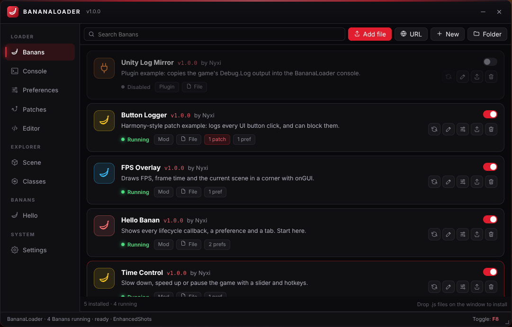
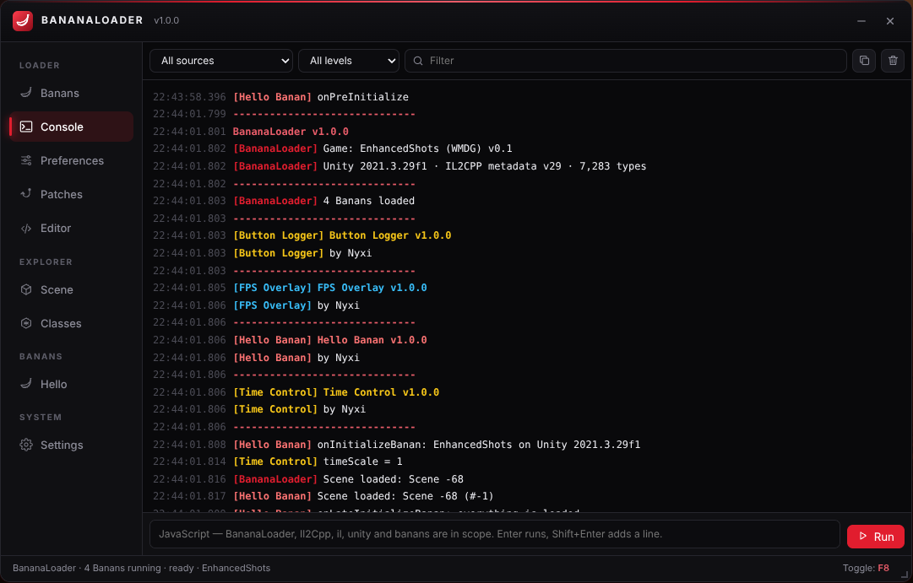
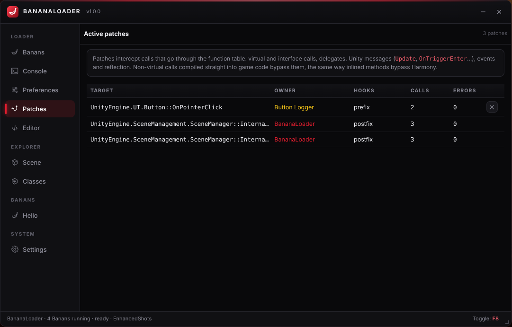
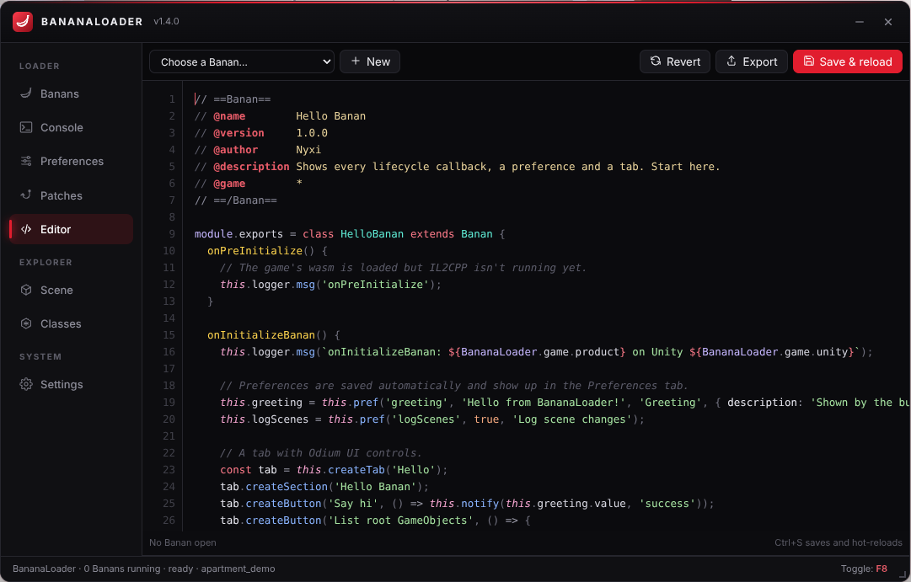
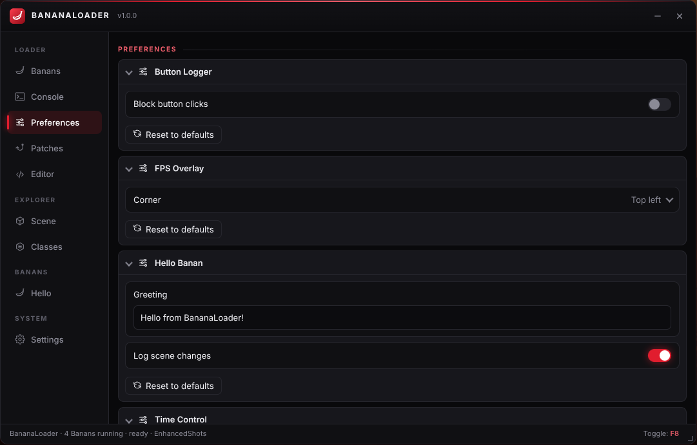

<div align="center">


# BananaLoader

**MelonLoader for Unity WebGL games, in JavaScript. Mods are called Banans: drop in a `.js` file and it hooks into the game's lifecycle, patches IL2CPP methods Harmony-style and reads and writes game objects like C#.**




</div>

## Table of Contents

- [What it is](#what-it-is)
- [Install](#install)
- [Your first Banan](#your-first-banan)
- [MelonLoader → BananaLoader](#melonloader--bananaloader)
- [The Banan header](#the-banan-header)
- [Lifecycle](#lifecycle)
- [Il2Cpp interop](#il2cpp-interop)
- [Patching (Harmony)](#patching-harmony)
- [Preferences](#preferences)
- [Logging](#logging)
- [Coroutines](#coroutines)
- [UI, keys and onGUI](#ui-keys-and-ongui)
- [Installing Banans](#installing-banans)
- [The window](#the-window)
- [Example Banans](#example-banans)
- [How it works](#how-it-works)
- [Limitations](#limitations)
- [Building](#building)
- [Project structure](#project-structure)
- [License](#license)

## What it is

[MelonLoader](https://github.com/LavaGang/MelonLoader) loads C# mods into Unity games on desktop. Unity WebGL games run IL2CPP compiled to WebAssembly in a browser tab, so there's nothing for MelonLoader to inject into. BananaLoader is the same idea built for the browser:

- **Banans** are JavaScript mods with MelonLoader's lifecycle: `onInitializeBanan`, `onSceneWasLoaded`, `onUpdate`, `onGUI` and the rest.
- **Il2Cpp interop:** game types and objects behave like JS objects, so `Il2Cpp.type('UnityEngine.Time').timeScale = 0.5` works.
- **Harmony-style patches:** prefixes and postfixes on IL2CPP methods. Prefixes can skip the original or replace the result.
- **Preferences:** saved settings per Banan, with controls generated in the UI.
- **Hot reload:** edit a Banan in the built-in editor and press <kbd>Ctrl</kbd>+<kbd>S</kbd>; it unloads (patches, tabs and timers included) and loads again without restarting the game.
- **Built-in Unity Explorer:** browse the scene, inspect objects and call methods, in the same window.
- **Odium UI:** black and red, toggled with <kbd>F8</kbd>.

## Install

1. Install [Tampermonkey](https://www.tampermonkey.net/) or [Violentmonkey](https://violentmonkey.github.io/).
2. Install `dist/bananaloader.user.js`.
3. Open a Unity WebGL game. BananaLoader appears once the game starts; press <kbd>F8</kbd> to show or hide it.
4. Drop the files from [`examples/`](examples) onto the window to try it out.

The userscript runs at `document-start` on every page but only shows up where a Unity WebGL build is running. To keep it to one site, change `@match`.

## Your first Banan

Press **New** in the Banans tab (or the Editor), or save this as `my-banan.js` and drop it on the window:

```js
// ==Banan==
// @name        Slow Motion
// @version     1.0.0
// @author      You
// @description Press F9 to toggle slow motion.
// ==/Banan==

module.exports = class SlowMotion extends Banan {
  onInitializeBanan() {
    this.Time = Il2Cpp.type('UnityEngine.Time');
    this.speed = this.pref('speed', 0.3, 'Slow-motion speed', { min: 0.05, max: 1, step: 0.05 });
    this.onKey('F9', () => {
      this.on = !this.on;
      this.Time.timeScale = this.on ? this.speed.value : 1;
      this.logger.msg(this.on ? 'Slow motion on' : 'Back to normal');
    });
  }

  onDeinitializeBanan() {
    this.Time.timeScale = 1;
  }
};
```

## MelonLoader → BananaLoader

| MelonLoader | BananaLoader |
| --- | --- |
| `MelonMod` / `MelonPlugin` | `Banan` / `BananPlugin` |
| `[assembly: MelonInfo(...)]` | the `// ==Banan==` header |
| `[assembly: MelonGame("Company", "Game")]` | `// @game Game Name` (wildcards allowed) |
| `Mods/` / `Plugins/` folder | installed Banans, or a linked folder on disk |
| `OnInitializeMelon` / `OnLateInitializeMelon` | `onInitializeBanan` / `onLateInitializeBanan` |
| `OnPreInitialization` / `OnApplicationStarted` (plugins) | `onPreInitialize` / `onApplicationStarted` |
| `OnSceneWasLoaded` / `OnSceneWasInitialized` / `OnSceneWasUnloaded` | same names, camelCase: `(buildIndex, sceneName)` |
| `OnUpdate` / `OnFixedUpdate` / `OnLateUpdate` / `OnGUI` | `onUpdate` / `onFixedUpdate` / `onLateUpdate` / `onGUI(gui)` |
| `OnDeinitializeMelon` / `OnApplicationQuit` | `onDeinitializeBanan` / `onApplicationQuit` |
| `OnPreferencesSaved` / `OnPreferencesLoaded` | `onPreferencesSaved` / `onPreferencesLoaded` |
| `MelonLogger.Msg / Warning / Error` | `this.logger.msg / warning / error` |
| `MelonPreferences.CreateCategory / CreateEntry` | `this.pref(...)` or `BananaLoader.Preferences.createCategory(...).createEntry(...)` |
| `HarmonyInstance.Patch(...)`, `[HarmonyPatch]` | `this.patch('Type::Method', { prefix, postfix })` |
| `MelonCoroutines.Start(IEnumerator)` | `this.startCoroutine(function* () { ... })` |
| `Il2CppInterop` generated proxies | `Il2Cpp.type(...)`, `Il2Cpp.find(...)`: proxies built at runtime |
| UnityExplorer (a separate mod) | built in: the Scene and Classes tabs |

## The Banan header

```js
// ==Banan==
// @name        Display name
// @version     1.2.0
// @author      You
// @description One line shown in the Banans tab.
// @game        Bullet Force        (repeatable; matches the product name; * = any; wildcards ok)
// @type        mod | plugin         (plugins load first and get onPreInitialize/onApplicationStarted)
// @color       #f5c518              (console colour; picked for you if omitted)
// @homepage    https://…
// ==/Banan==
```

The code sets `module.exports` to a class extending `Banan` (or `BananPlugin`), or to a plain object of callbacks. These are in scope: `Banan`, `BananPlugin`, `BananaLoader`, `Il2Cpp`, `logger` and `Ref`.

## Lifecycle

Every callback is optional. They run in this order:

| Callback | When |
| --- | --- |
| `onPreInitialize()` | The game's wasm has loaded but no game code has run yet. Use it to hook the page or the Emscripten `Module` (`this.loader.Module`). |
| `onApplicationStarted()` | Plugins only: IL2CPP is up, before mods initialize. |
| `onInitializeBanan()` | IL2CPP and the engine are ready. Patch, read types and create preferences and tabs here. |
| `onLateInitializeBanan()` | Every Banan has initialized and the first frame has run. |
| `onSceneWasLoaded(buildIndex, name)` | A scene finished loading. This hooks `SceneManager.sceneLoaded`, so it also fires for additive loads. |
| `onSceneWasInitialized(buildIndex, name)` | One frame later, after the scene's `Awake` and `Start`. |
| `onSceneWasUnloaded(buildIndex, name)` | A scene was unloaded. |
| `onUpdate()` / `onLateUpdate()` | Every frame, right after Unity's frame. They run through the Emscripten main loop, so the timing is exact. |
| `onFixedUpdate()` | At `Time.fixedDeltaTime` steps of scaled time. |
| `onGUI(gui)` | Every frame, to draw on the overlay. |
| `onPreferencesSaved()` / `onPreferencesLoaded()` | After preferences are written to or read from storage. |
| `onDeinitializeBanan()` | The Banan is being disabled, reloaded or deleted. |
| `onApplicationQuit()` | The page is closing. |

A Banan enabled or installed while the game is running catches up: it gets every callback it would have had, including `onSceneWasLoaded` for the scenes that are already open. A callback that keeps throwing is switched off after 25 errors; the first few are logged.

## Il2Cpp interop

`Il2Cpp` turns game types and objects into JavaScript proxies, built from the game's metadata at runtime:

```js
const Time = Il2Cpp.type('UnityEngine.Time');
Time.timeScale = 0.5;                                // static property setter
Time.deltaTime;                                       // static property getter

const cam = Il2Cpp.find('UnityEngine.Camera');        // first live object of a type
cam.transform.position = { x: 0, y: 20, z: -10 };     // structs are plain objects
cam.WorldToScreenPoint({ x: 0, y: 0, z: 0 });         // methods; the overload is picked by your arguments

const player = Il2Cpp.find('PlayerController');       // game types work the same way
player.health = 100;                                  // fields (auto-property backing fields too)
player.Respawn();
player.$component('UnityEngine.Rigidbody').velocity;  // GetComponent on the same GameObject

Il2Cpp.gameObject('Main Camera');                     // GameObject by name
Il2Cpp.gameObjects(/Enemy/);                          // every GameObject matching a RegExp
Il2Cpp.findAll('EnemyAI');                            // every live instance
Il2Cpp.new('UnityEngine.GameObject', 'Spawned');      // constructors
Il2Cpp.type('PlayerController').Instance;             // static fields

const out = Il2Cpp.ref(0);                            // ref / out parameters
Il2Cpp.type('System.Int32').TryParse('42', out);      // true, out.value === 42
```

| On a proxy | |
| --- | --- |
| `$ptr` | the object's address |
| `$type` | its full type name |
| `$is('Type')` | an `is` check |
| `$static` | the type's static side |
| `$component('Type')` | a component on the same GameObject |
| `$toArray()` | the elements of a `List<T>`, `Dictionary` or array |
| `$get(name)` / `$set(name, v)` / `$call(name, ...args)` | explicit member access, for names that clash with JS |

Arrays are proxies too: index into them, read `length`, or use `for…of`.

Values convert like this: strings ↔ JS strings, numbers, booleans, `long` ↔ BigInt, enums ↔ numbers, structs ↔ plain objects, and objects ↔ proxies (`null` for null). The raw bridge is still there as `Il2Cpp.il`, along with the scene helpers as `Il2Cpp.unity`.

## Patching (Harmony)

```js
this.patch('UnityEngine.UI.Button::OnPointerClick', {
  prefix(ctx) {
    this.logger.msg(`Clicked ${ctx.instance.gameObject.name}`);
    return true;                 // return false to skip the original method
  },
});

this.patch('Weapon::GetDamage', {
  sig: 0,                        // pick an overload: parameter count or ['System.Single', ...]
  postfix(ctx) {
    ctx.result = ctx.result * 2; // change the return value
  },
});
```

| `ctx` | |
| --- | --- |
| `instance` | `this` as a proxy (`self` is the raw pointer) |
| `arg(i)` / `setArg(i, v)` | read or replace an argument, as JS values |
| `args` | the raw wasm arguments |
| `result` | read or set the return value. Setting it in a prefix also skips the original |
| `skipOriginal` | set to `true` to skip the original |
| `callOriginal()` | run the original yourself |
| `method`, `name`, `argCount`, `paramName(i)` | about the patched method |

Patches belong to the Banan that made them and are removed when it unloads. `this.patch()` returns a handle with `.unpatch()`. Several Banans can patch the same method; `priority` sets the order. The **Patches** tab lists every active patch with its call and error counts.

**What can be patched:** any call that goes through the wasm function table, which covers:
- virtual and interface methods
- Unity messages (`Update`, `FixedUpdate`, `OnTriggerEnter`, `OnPointerClick`, …)
- delegates and events, `Invoke` and reflection
- engine callbacks such as `SceneManager.sceneLoaded`

Calls to non-virtual methods that IL2CPP compiled directly into game code go straight to the function and skip the patch. It's the same situation as Harmony and inlined methods. To catch those, patch the virtual or engine-called method that leads to them.

## Preferences

```js
const fov = this.pref('fov', 90, 'Field of view', { min: 60, max: 120, step: 1, description: 'Camera FOV' });
fov.value;                               // read
fov.value = 100;                         // write: saved automatically, the UI updates
fov.onChange((v, old) => apply(v));

this.pref('mode', 'Fast', 'Mode', { options: ['Fast', 'Pretty'] });   // dropdown
this.pref('key', 'F5', 'Hotkey', { kind: 'key' });                     // key picker
this.pref('tint', '#e11d2e', 'Tint', { kind: 'color' });               // colour picker
```

The control type depends on the default value and options: a toggle for booleans, a slider for numbers with `min` and `max` (a number box otherwise), a dropdown when there are `options`, and a text box for other strings. Values are stored in `localStorage` per category and entry, and they survive reloads and reinstalls.

## Logging

`this.logger.msg / warning / error / success / debug / big` write to the BananaLoader console in the Banan's colour, and to the browser console. `BananaLoader.logger('Name', '#hex')` gives you a logger of your own.

## Coroutines

```js
this.startCoroutine(function* () {
  this.logger.msg('waiting 3 seconds');
  yield 3;                       // seconds
  yield;                         // one frame
  yield { frames: 10 };          // ten frames
  const r = yield fetch(url);    // until a promise settles; resumes with its value
});
```

Coroutines run once per game frame and stop when their Banan unloads.

## UI, keys and onGUI

```js
const tab = this.createTab('My Banan');          // an Odium UI tab under "Banans"
tab.createToggle('God mode', (on) => { ... });
tab.createSlider('Speed', (v) => { ... }, { min: 0, max: 10 });

this.onKey('F6', () => { ... });                 // hotkey, also while the game has focus
this.notify('Saved!', 'success');                // toast

onGUI(gui) {                                     // overlay canvas, redrawn every frame
  gui.box(10, 10, 160, 40);
  gui.text('Hello', 20, 20, { color: '#f5c518', size: 16 });
  gui.line(x1, y1, x2, y2, { color: '#e11d2e' });
  const p = gui.worldToScreen(Il2Cpp.find('UnityEngine.Camera'), enemy.transform.position);
  gui.ctx;                                       // the raw CanvasRenderingContext2D
}
```

Tabs, hotkeys, timers (`this.setInterval`, `this.setTimeout`), patches and coroutines are all cleaned up when a Banan unloads.

## Installing Banans

- **Add file / drag and drop:** `.js` files, stored in the browser (IndexedDB).
- **URL:** downloads a raw `.js` file. Banans installed this way get an **Update** button.
- **New / Editor:** write one in the browser.
- **Folder:** link a folder on your computer (Chromium browsers only), like MelonLoader's `Mods` folder. Edit the files in your own editor, then use **Reload from folder** to hot-reload what changed.
- **Settings → Export all Banans / Import backup** moves your setup between browsers.

Turning on **Safe mode** in Settings starts the game with every Banan disabled, so you can get past a broken one.

## The window

| | |
| --- | --- |
|  **Console**: every Banan's log, filterable, plus a JS prompt |  **Patches**: live patch list with call counts |
|  **Editor**: write a Banan and hot-reload it with Ctrl+S |  **Preferences**: generated from each Banan's entries |

The **Scene** and **Classes** tabs are Unity Explorer, built in: a hierarchy, an inspector with live editing and method calls, and a class browser. From the console prompt, `inspect(obj)` opens any proxy in them.

## Example Banans

| File | Shows |
| --- | --- |
| [`hello-banan.js`](examples/hello-banan.js) | every lifecycle callback, preferences, a tab and a hotkey |
| [`time-control.js`](examples/time-control.js) | static property interop and preferences with `onChange` (F9 pause, Ctrl+↑/↓) |
| [`fps-overlay.js`](examples/fps-overlay.js) | `onGUI` drawing and a dropdown preference |
| [`button-logger.js`](examples/button-logger.js) | a Harmony-style prefix that can skip the original |
| [`log-mirror.js`](examples/log-mirror.js) | a plugin using `onPreInitialize` to catch the engine's first log lines |

## How it works

1. **Attach.** A `document-start` hook catches the Emscripten `Module` the moment the framework assigns `Module.asm`, before the game's `main` runs. Banans are read from IndexedDB in the meantime, and their `onPreInitialize` runs right there.
2. **IL2CPP bridge** (shared with Unity Explorer):
   - `global-metadata.dat` is read straight out of the heap. It holds the name of every type, method, field and property.
   - `Il2CppCodeRegistration` maps each method to its index in the wasm function table.
   - The `Il2CppClass` layout is worked out by testing it against `System.String`.
   - Methods are called directly with IL2CPP's calling convention.
3. **Frames.** BananaLoader chains Emscripten's `Module.postMainLoop`, so `onUpdate` and the rest run right after each Unity frame, which is also when it's safe to call into managed code.
4. **Patching.**
   - A tiny wasm module is generated that imports the JS hook and re-exports it with the method's exact wasm signature (the same trick as Emscripten's `addFunction`).
   - The method's slot in the function table is swapped for that function. Every indirect call (vtables, `MethodInfo`, delegates, invokers) now lands in the hook, and the original is kept to call through to.
   - Unpatching swaps the original back in.
5. **Scenes.** BananaLoader patches `SceneManager.Internal_SceneLoaded` and `Internal_SceneUnloaded`, which the engine calls for every load. If a build lacks them, it polls instead.

## Limitations

- **Direct calls skip patches.** Non-virtual calls compiled straight into game code don't go through the function table (see [Patching](#patching-harmony)).
- **Generics.** Generic methods and methods of generic types can't be patched or called, though their objects can still be read and written.
- **Stripped code.** Anything the game never used isn't in the build. Accessing a stripped member returns `undefined`, and calling one throws a clear error.
- **Scene names.** If a build strips the scene-name APIs, scenes are reported as `Scene <handle>`.
- **Banans run in the page with the game's privileges.** Only install Banans you trust, just as you would with DLL mods.

## Building

```bash
bun scripts/build.js             # minified -> dist/bananaloader.user.js and dist/bananaloader.js
bun scripts/build.js --readable  # unminified
```

## Project structure

```
bananaloader/
├── src/
│   ├── main.js              entry: hooks, loader, window
│   ├── hook.js              document-start: Module capture, key shield
│   ├── loader/
│   │   ├── loader.js        Banan lifecycle, scenes, frames, install/reload
│   │   ├── banan.js         Banan / BananPlugin base classes, header parser, compiler
│   │   ├── interop.js       Il2Cpp proxies
│   │   ├── patcher.js       Harmony-style patching through the function table
│   │   ├── wasmfn.js        JS function -> typed wasm function
│   │   ├── prefs.js         BananaPreferences
│   │   ├── logger.js        loggers and the console feed
│   │   ├── coroutines.js    generator coroutines
│   │   ├── overlay.js       onGUI canvas
│   │   └── store.js         IndexedDB and linked folder
│   ├── app/                 the window: Banans, Console, Preferences, Patches, Editor, Settings
│   ├── il2cpp/              IL2CPP bridge (from Unity Explorer)
│   ├── ui/                  explorer views (from Unity Explorer)
│   └── odium/               Odium UI
├── examples/                example Banans
└── scripts/build.js
```

## License

[MIT with attribution](LICENSE.md). © 2025-2026 Nyxi. BananaLoader is inspired by [MelonLoader](https://github.com/LavaGang/MelonLoader) but shares no code with it.
# bananaloader-webgl

